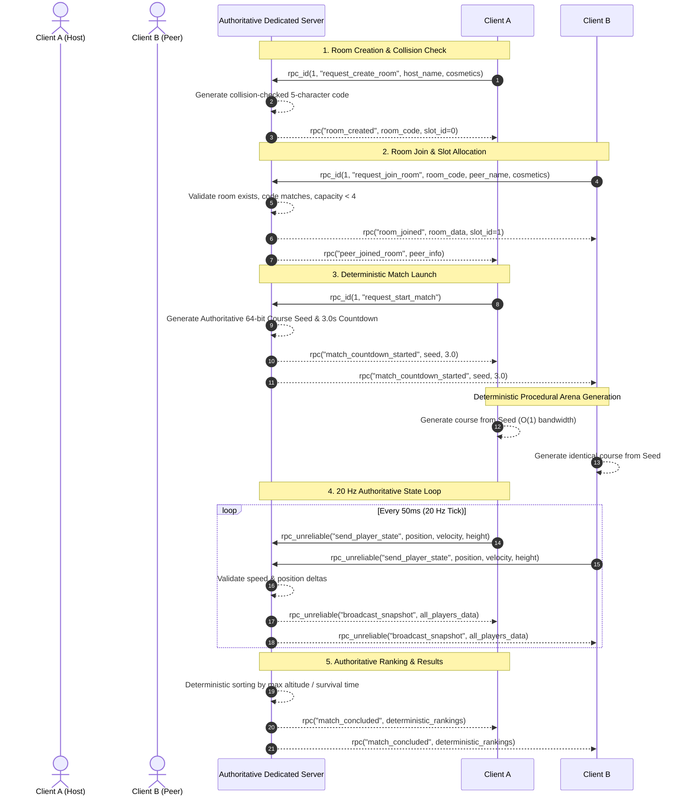
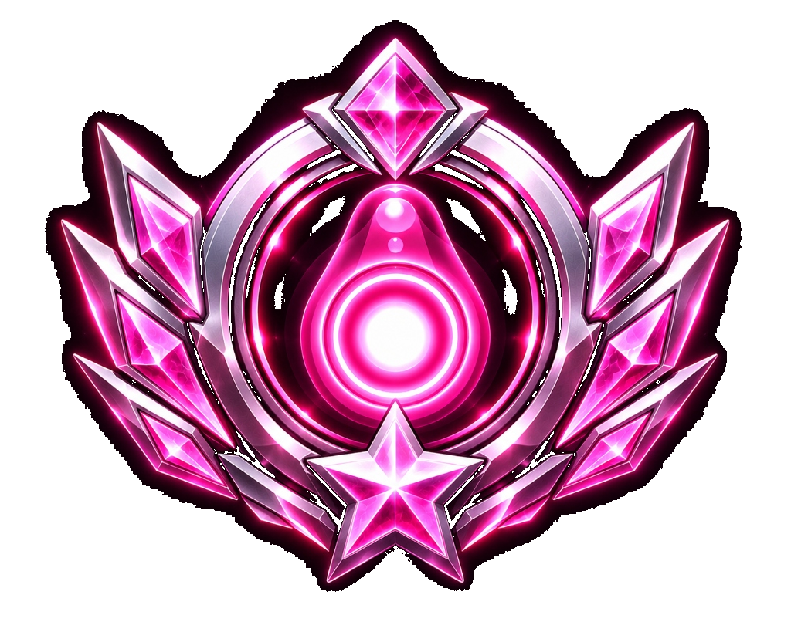
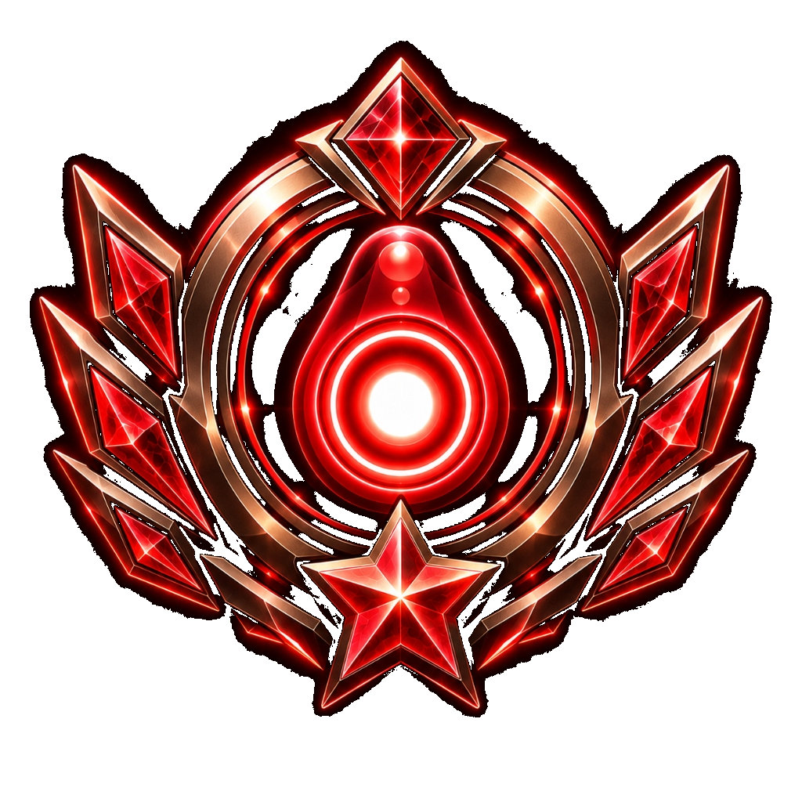

<div align="center">

# ⚡ BOUNZO: Real-Time Multiplayer & Mobile Arcade Engine

### Authoritative UDP Multiplayer Architecture & Cross-Platform Game Engine
**Engineered with Godot Engine 4 (GDScript 2.0) • Headless Dedicated Cloud Server • 60 FPS Mobile Architecture**

[](#)
[](https://play.google.com/store/apps/details?id=com.ayzus.bounzo)
[](https://godotengine.org/)
[](https://en.wikipedia.org/wiki/User_Datagram_Protocol)
[](https://fly.io)
[-brightgreen.svg?style=for-the-badge)](test_multiplayer.gd)
[](LICENSE)

<p align="center">
  <b>Project:</b> <code>BOUNZO Multiplayer Engine</code> &nbsp;|&nbsp; 
  <b>Architecture:</b> Authoritative UDP Dedicated Server (20 Hz) &nbsp;|&nbsp; 
  <b>Target Platforms:</b> Android & Cross-Platform PC
</p>

</div>

---

> [!NOTE]
> **Release Status Notice**:  
> The single-player core game is published on Google Play (`com.ayzus.bounzo`). **This repository contains the advanced real-time Authoritative Multiplayer Architecture & Dedicated Server**, currently in pre-release staging / portfolio review, featuring custom UDP networking, deterministic seed synchronization, containerized cloud deployment, and automated headless integration testing.

---

## 🎯 Executive Summary for Technical Recruiters & Engineering Leads

**BOUNZO** is an end-to-end arcade survival platformer with a distributed authoritative multiplayer architecture. While the foundational single-player version is published on Google Play, this project scales the game into a **real-time 4-player competitive survival racer** powered by a dedicated UDP server, deterministic seed synchronization, and zero-allocation gameplay loops.

### Key Engineering Domains Demonstrated:
1. **Real-Time Distributed Systems**: Authoritative dedicated server model, client-side dead reckoning, UDP RPC synchronization at 20 Hz, and strict packet rate limiting (35 pps).
2. **Deterministic Procedural Generation**: Seed-based arena generation ($O(1)$ network overhead) ensuring 100% bitwise-identical obstacles across 4 connected peers.
3. **Rigorous Quality Engineering**: 20/20 headless integration test suite executed on CI/CD CLI with zero regressions.
4. **Mobile Performance Engineering**: Locked 60 FPS on low-to-high-end Android devices, runtime PCM waveform procedural audio synthesis, and custom GL Compatibility rendering pipeline.
5. **Cloud DevOps & Edge Containerization**: Containerized headless Linux microVM deployment via Docker and Fly.io global UDP edge routing.
6. **Data Integrity & Monetization**: Version 5 JSON atomic save schema, tamper-proof economy, and safe asynchronous Google AdMob state machine.

---

## 🏗️ Deep-Dive Architecture & Engineering Achievements

### 1. Authoritative Client-Server Real-Time Networking
- **Decoupled Dedicated Server**: Fully standalone headless server scene (`res://scenes/multiplayer/server_main.tscn`) driven by `dedicated_server.gd`, `match_manager.gd`, and `room_manager.gd`. The server can run headlessly inside any minimal Linux container with no graphical dependencies.
- **20 Hz UDP State Pipeline**: Player transforms, velocities, and altitudes are synchronized at 20 Hz using Godot's high-performance ENet UDP layer. Non-critical state uses unreliable-ordered channels, while match state, room transitions, and countdown events use reliable channels.
- **Anti-Cheat & Anomaly Detection**:
  - Authoritative validation of vertical velocity, maximum jump height, and horizontal impulse.
  - Rate limiting clamped at 35 packets/sec per peer to mitigate packet flooding and socket exhaustion.
  - Room capacity limits enforced strictly at the server boundary (5th connections automatically rejected with protocol error).
- **Smooth Remote Interpolation**: Remote player avatars (`remote_player.gd`) utilize cubic interpolation with velocity extrapolation and dead reckoning, eliminating jitter across variable mobile network latency.



### 2. Deterministic Seed-Based Procedural Generation
- **Zero-Bandwidth Level Sync**: Traditional multiplayer games replicate hundreds of level entities across the network. BOUNZO eliminates this entirely by distributing a single authoritative 64-bit seed upon match launch.
- **Bitwise Identical Arenas**: The client-side `multiplayer_platform_generator.gd` utilizes this seed to deterministically place normal, moving, spring, and fragile platforms along with hazards (laser gates, closing traps, wind zones). Every peer experiences the exact same obstacle distribution with $O(1)$ network overhead.

### 3. Procedural Reachability Physics (Single-Player & Multiplayer)
- Based on the player's bounce impulse ($760\text{ px/s}$), horizontal control velocity ($380\text{ px/s}$), and gravity ($1400\text{ px/s}^2$), platform coordinates are calculated such that every generated vertical leap is mathematically proven to be reachable:
  $$\Delta y_{\text{max}} = \frac{v_{\text{bounce}}^2}{2g} \approx 206.3\text{ px}$$
- Off-screen platforms ($900\text{ px}$ below viewport) are automatically recycled via object pools to prevent garbage collection spikes.

### 4. Zero-Dependency Procedural Audio Synthesizer
- In `scripts/audio_manager.gd`, rather than relying on heavy WAV/OGG files for sound effects, BOUNZO features a custom runtime PCM audio synthesizer written in GDScript.
- Dynamically computes sine, square, and filtered noise buffers at $22,050\text{ Hz}$ with linear pitch ramps (landing pops, coin collection chimes, combo multiplier frequency sweeps).

### 5. Competitive 7-Tier Ranking Ladder
A complete skill-based progression ladder featuring custom particle shaders, star thresholds, and difficulty scaling:

| Rank Tier | Skill Rating | Hazard Complexity | Stars Required |
|:---:|:---:|---|:---:|
| **Bronze** | Beginner | Standard static platforms, basic bounces | 3 Stars |
| **Silver** | Intermediate | Oscillating platforms, narrow clearances | 4 Stars |
| **Gold** | Advanced | Moving & fragile collapsing platforms | 5 Stars |
| **Platinum** | Elite | Wind force vectors & tight timing | 6 Stars |
| **Diamond** | Master | Ghost wind, timed crusher traps | 6 Stars |
| **Master** | Grandmaster | Laser gates, combined hazards | 6 Stars |
| **Grandmaster** | Top 1% | Maximum chaos, adaptive speed scaling | 6 Stars |

<div align="center">
  
  
  
  
  
  
  
</div>

---

## 🧪 Comprehensive Automated Headless Test Suite

The project includes an automated headless integration test suite (`test_multiplayer.gd`) run directly via the Godot console executable. Every subsystem is verified against edge cases:

```powershell
# Run the complete test suite headlessly via Godot CLI
godot --headless -s test_multiplayer.gd
```

### Verified Test Matrix (100% Passing):

| # | Test Case | Category | Status | Verified Behavior |
|:---:|---|---|:---:|---|
| **01** | Single-Player Startup | Engine Lifecycle | **PASS** | `game.tscn` compiles & instantiates with zero warnings |
| **02** | Save Schema Compatibility | Persistence | **PASS** | Schema v5 JSON integrity verified across legacy saves |
| **03** | Economy & Cosmetics | Game Economy | **PASS** | Ball skins, glow shaders, and trails unlocked atomically |
| **04** | Rank & Ladder Logic | Progression | **PASS** | Tier transitions and star thresholds accurately validated |
| **05** | AdMob Reward Injection Guard | Monetization | **PASS** | Unearned rewards rejected; callbacks strictly verified |
| **06** | 2-Player Room Join Flow | Networking | **PASS** | Room created, code assigned, peer connected to Slot 1 |
| **07** | 4-Player Capacity Saturation | Concurrency | **PASS** | 4 distinct peers successfully bound to Slots 0–3 |
| **08** | Room Overflow Boundary Guard | Security | **PASS** | 5th connection rejected with `"Room is full"` protocol error |
| **09** | Room Code Sanitization | Input Validation | **PASS** | Ambiguous characters (0, O, 1, I) filtered out |
| **10** | Synchronized Host Countdown | Match Flow | **PASS** | Match launch blocked until all ready; 3.0s sync countdown |
| **11** | Match Lifecycle Transition | State Machine | **PASS** | Clean transition from COUNTDOWN to IN_GAME to RESULTS |
| **12** | Authoritative Score Ranking | Anti-Cheat | **PASS** | Deterministic sorting by max altitude without disputes |
| **13** | Concurrent Client Disconnects | Fault Tolerance | **PASS** | Dynamic slot deallocation and peer cleanup |
| **14** | Dynamic Host Migration | High Availability| **PASS** | Host privileges cleanly transferred when host disconnects |
| **15** | Socket Timeout Detection | Network Stability| **PASS** | 6.0s timeout timer verified with automatic reconnection |
| **16** | Rematch & Reset Flow | State Machine | **PASS** | Room state cleanly reset to lobby for subsequent rounds |
| **17** | Android Touch Coordinates | Input Mapping | **PASS** | Screen split (< 270px left, > 270px right) mapped to [-1, 1] |
| **18** | Headless Cold Reboot | Infrastructure | **PASS** | Memory reset with zero orphan peer or room references |
| **19** | Anti-Spam Packet Throttling | DDoS Protection | **PASS** | High-frequency packet spam throttled at 35 pps threshold |
| **20** | Single-Player Save Isolation | Data Protection | **PASS** | Multiplayer results strictly isolated from single-player save |

---

## 🗂️ Clean Repository Architecture

```text
BOUNZO-MULTIPLAYER/
├── .gitignore                    # Enterprise gitignore filtering all keys, builds, and artifacts
├── LICENSE                       # Proprietary Source-Available Evaluation License
├── README.md                     # Engineering documentation and technical highlights
├── project.godot                 # Engine config, GL Compatibility, 60 FPS cap, autoloads
├── export_presets.cfg            # Clean production Android export configuration
├── server_config.json            # Server networking and gameplay parameters
├── Dockerfile                    # Container build file for headless Linux dedicated server
├── fly.toml                      # Fly.io global cloud deployment orchestration
│
├── scenes/                       # Declarative Godot scene hierarchy
│   ├── game/                     # Core single-player game loop and HUD
│   ├── multiplayer/              # Dedicated server, lobby UI, arena, remote players
│   ├── platform/                 # Procedural platform entities
│   ├── player/                   # Character physics body and trail emitters
│   └── splash/                   # Boot sequence
│
├── scripts/                      # Object-oriented GDScript architecture
│   ├── multiplayer/              # Real-time networking engine
│   │   ├── dedicated_server.gd   # Headless CLI server daemon
│   │   ├── match_manager.gd      # Authoritative match orchestration & state sync
│   │   ├── room_manager.gd       # 4-player room registry and host migration
│   │   ├── multiplayer_protocol.gd# RPC signatures, packet validation, and limits
│   │   ├── multiplayer_manager.gd# Client-side network lifecycle & socket management
│   │   ├── remote_player.gd      # Smooth interpolation & ghost avatar rendering
│   │   └── multiplayer_platform_generator.gd # Seeded deterministic course builder
│   ├── ad_manager.gd             # AdMob monetization engine with callback safety
│   ├── audio_manager.gd          # Procedural audio waveform synthesizer
│   ├── camera_controller.gd      # Dynamic vertical tracking camera with smooth damping
│   ├── challenge_manager.gd      # 7-tier rank progression and unlock system
│   ├── game.gd                   # Primary single-player finite state machine
│   ├── platform_generator.gd     # Single-player dynamic difficulty platform generator
│   ├── player.gd                 # Rigid-body 2D player controller with responsive touch
│   ├── save_manager.gd           # Atomic file I/O with v5 JSON schema validation
│   └── ui_theme.gd               # Cyber neon procedural UI design system
│
├── test_multiplayer.gd           # 20-test automated headless integration test suite
├── test_network_live.gd          # Live UDP socket loopback diagnostic tool
└── assets/                       # High-resolution optimized graphics, audio, and video
```

---

## 💻 Tech Stack & Tooling

- **Game Engine**: Godot Engine 4.7+ (GL Compatibility Renderer)
- **Language**: GDScript 2.0 (Strongly-typed, Object-Oriented, Signal-driven)
- **Networking**: Godot High-Level Multiplayer / ENet UDP / Custom RPC Protocol
- **Server Infrastructure**: Headless Linux container (`ubuntu:22.04`), Docker, Fly.io Edge
- **Target OS**: Android (API 21+, ARM64 / ARMv7) & Cross-Platform Desktop (Windows / Linux / macOS)
- **Monetization SDK**: Google Mobile Ads (AdMob)
- **Testing**: Automated Headless CLI Integration Test Suite

---

## 🚀 Local Setup & Quick Start

### Prerequisites
- **Godot Engine 4.7+** (Standard 64-bit edition)
- **Git**

### 1. Clone the Repository
```bash
git clone https://github.com/MohammedAyman07/BOUNZO.git
cd BOUNZO
```

### 2. Running the Local Authoritative Server
Launch the dedicated server headlessly on port 7777:
```powershell
# Using the Windows batch runner
.\START_LOCAL_SERVER.bat

# Or directly via Godot CLI
godot --headless -- --server --port=7777
```

### 3. Launching Game Clients
Run two instances to test multiplayer locally:
```powershell
# Launch Client 1
godot

# Launch Client 2 (in a separate terminal)
godot
```
1. Click **MULTIPLAYER** on the main menu.
2. Client 1: Click **CREATE ROOM** to generate a 5-character room code.
3. Client 2: Enter the room code and click **JOIN ROOM**.
4. Both players click **READY**, and the host clicks **START RACE**.

### 4. Running the Headless Test Suite
```powershell
godot --headless -s test_multiplayer.gd
```

---

## 🔒 Security, Hygiene & Zero-Secrets Guarantee

This repository enforces strict production repository hygiene:
- **No Keystores or Private Keys**: Android release signing keystores (`*.keystore`, `*.jks`) and credential manifests (`export_credentials.cfg`) are strictly excluded via `.gitignore`.
- **No Bulky Build Artifacts**: Heavy generated binaries (`*.apk`, `*.aab`, Gradle caches, `.godot` cache artifacts) have been cleanly excluded.
- **Pure Source Integrity**: Only pure source files, scenes, documentation, scripts, and production assets are tracked.

---

## 📄 License & Evaluation Rights

This software is distributed under a **Proprietary Source-Available Evaluation License**.  
Copyright © 2026 Mohammed Ayman (Ayzus). All rights reserved.

> **Evaluation Permission:** Technical recruiters, engineering hiring managers (including Google, Meta, and peer technology companies), and code reviewers are granted full permission to view, clone, and execute this codebase locally for the purpose of candidate evaluation and technical assessment.  
> Commercial exploitation, reproduction, distribution, or public hosting without prior written permission is strictly prohibited. Refer to [`LICENSE`](LICENSE) for complete terms.

---

## 👤 Author & Contact

**Mohammed Ayman**  
- **Email**: [mohammedayman0107@gmail.com](mailto:mohammedayman0107@gmail.com)  
- **GitHub**: [@MohammedAyman07](https://github.com/MohammedAyman07)  
- **Google Play (Single-Player Base)**: [BOUNZO on Google Play Store](https://play.google.com/store/apps/details?id=com.ayzus.bounzo)  
- **Role Focus**: Software Engineer / Game Systems & Network Programmer (Distributed Systems, Real-Time Physics, Engine Architecture)
