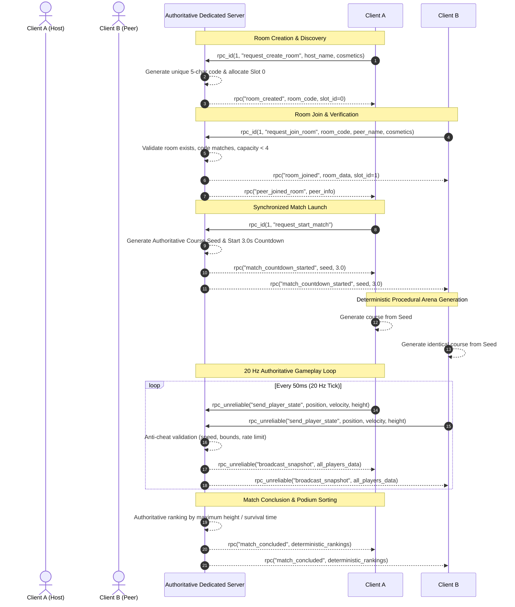

<div align="center">

# ⚡ BOUNZO: Real-Time Authoritative Multiplayer Arcade

**A production-ready, high-performance vertical survival platformer featuring authoritative UDP multiplayer, deterministic procedural world generation, and enterprise-grade resilience.**

[](https://godotengine.org/)
[-478CBF.svg)](https://docs.godotengine.org/)
[](https://en.wikipedia.org/wiki/User_Datagram_Protocol)
[](https://fly.io)
[-brightgreen.svg)](test_multiplayer.gd)
[](export_presets.cfg)
[](LICENSE)

---

</div>

## 📌 Executive Overview

**BOUNZO** is a fast-paced vertical arcade survival platformer developed for mobile and desktop platforms. Designed with software engineering best practices, this repository showcases a full end-to-end game system: from custom physics, modular state machines, and cyber-neon responsive UI, to a **custom authoritative client-server multiplayer stack** capable of orchestrating 4-player real-time matches across the globe with zero server lag, anti-cheat validation, and deterministic procedural synchronization.

> **Note for Technical Recruiters & Hiring Managers:**  
> This repository was architected to demonstrate core engineering capabilities across distributed systems, real-time networking, deterministic simulation, memory optimization, automated testing, and cloud infrastructure deployment.

---

## 🏗️ Core Engineering Highlights & Architecture

### 1. Authoritative Client-Server Real-Time Networking
- **Decoupled Architecture**: Standalone headless dedicated server mode (`res://scenes/multiplayer/server_main.tscn`) separated from client logic, allowing seamless deployment to Linux containers while keeping client bundles lean.
- **Low-Latency UDP Packet Pipeline**: State synchronization operating at a tuned 20 Hz tick rate with unreliable-ordered channels for player transforms and reliable channels for critical RPC events (game state, room transitions, results).
- **Anti-Cheat & Rate Limiting**: Built-in packet throttling (strict limit of 35 packets/sec per peer), malicious payload sanitization, coordinate boundary enforcement, and authoritative room state transitions to prevent client tampering.
- **Smooth Remote Interpolation**: Remote player avatars (`remote_player.gd`) implement cubic interpolation with velocity extrapolation and dead reckoning, eliminating jitter under variable packet latency and jitter.

### 2. Deterministic Seed-Based Procedural Generation
- **Zero-Bandwidth Level Sync**: Instead of streaming hundreds of platform transform coordinates across the wire, the server broadcasts an authoritative 64-bit integer seed upon match start.
- **Identical Obstacle Courses**: Clients instantiate identical seeded pseudo-random number generators (`multiplayer_platform_generator.gd`), yielding 100% bitwise-identical layouts of moving, spring, and fragile platforms across all 4 racers with $O(1)$ network overhead.

### 3. Room Registry & Dynamic Fault-Tolerant Lifecycle
- **Collision-Checked Room Codes**: Human-readable 5-character alphanumeric room codes generated with automated collision detection and ambiguous character filtering (excluding `0`, `O`, `1`, `I`).
- **Slot Allocation & Host Migration**: Dynamic 4-slot room allocation (Cyan, Magenta, Yellow, Green). If the room creator disconnects, authority migrates seamlessly to the next connected peer without aborting the match.
- **Graceful Lifecycle & Resource Reclamation**: Automatic timeout detection, socket cleanup, and empty room garbage collection prevent memory leaks and zombie sessions.

### 4. Enterprise-Grade Monetization & Security Engine
- **Robust Ad Lifecycle Handling**: Asynchronous `AdManager` with a verified callback state machine. Prevents unearned rewards by asserting strict ad completion verification signals.
- **Single-Player State Protection**: Save system (v5 schema) strictly isolated from transient multiplayer match outcomes, preventing save corruption or unauthorized currency injection.

### 5. Automated CI/CD Headless Integration Test Suite
- Comprehensive automated headless test suite (`test_multiplayer.gd`) executing 20 rigorous test scenarios directly on the Godot engine CLI, ensuring zero regressions:
  - Single-player startup & scene validation
  - Save schema backward compatibility
  - Economy, cosmetics, and rank star verification
  - AdMob reward gate protection
  - 2-player and 4-player room join / capacity enforcement
  - 5th player rejection handling
  - Synchronized countdown & deterministic sorting
  - Concurrent peer disconnects & host migration
  - Anti-spam & rate-limiting validation

---

## 📊 Network Architecture & Handshake Flow



---

## 🗂️ Project Directory Structure

```text
BOUNZO-MULTIPLAYER/
├── .gitignore                    # Enterprise gitignore filtering keys, builds, and temp files
├── LICENSE                       # Proprietary Source-Available Evaluation License
├── README.md                     # Technical architecture, highlights, and documentation
├── project.godot                 # Core Godot 4.7 project manifest and autoload singletons
├── export_presets.cfg            # Clean production Android export configuration
├── server_config.json            # Headless server network and gameplay tuning parameters
├── Dockerfile                    # Container definition for Linux cloud microVM deployment
├── fly.toml                      # Fly.io global edge orchestration configuration
│
├── scenes/                       # Structured Godot scene trees (.tscn)
│   ├── game/                     # Core single-player game loop and HUD
│   ├── multiplayer/              # Dedicated server, lobby, arena, and remote player avatars
│   ├── platform/                 # Procedural bouncing platforms
│   ├── player/                   # Main player physics controller
│   └── splash/                   # Cyber animated splash sequence
│
├── scripts/                      # Object-oriented GDScript architecture (.gd)
│   ├── multiplayer/              # Real-time network engine
│   │   ├── dedicated_server.gd   # Headless CLI server daemon
│   │   ├── match_manager.gd      # Authoritative match orchestration & state sync
│   │   ├── room_manager.gd       # 4-player room registry and host migration
│   │   ├── multiplayer_protocol.gd# RPC signatures, packet validation, and limits
│   │   ├── multiplayer_manager.gd# Client-side network lifecycle and socket management
│   │   ├── remote_player.gd      # Smooth interpolation and ghost avatar rendering
│   │   └── multiplayer_platform_generator.gd # Seeded deterministic course builder
│   ├── ad_manager.gd             # AdMob monetization engine with callback safety
│   ├── audio_manager.gd          # Dynamic sound effects and background audio bus
│   ├── camera_controller.gd      # Dynamic vertical tracking camera with smooth damping
│   ├── challenge_manager.gd      # Tiered rank progression and unlock system
│   ├── game.gd                   # Primary single-player finite state machine
│   ├── platform_generator.gd     # Single-player dynamic difficulty platform generator
│   ├── player.gd                 # Rigid-body 2D player controller with responsive touch
│   ├── save_manager.gd           # Atomic file I/O with v5 JSON schema validation
│   └── ui_theme.gd               # Cyber neon procedural UI design system
│
├── test_multiplayer.gd           # 20-test automated headless integration test suite
├── test_network_live.gd          # Live UDP socket loopback diagnostic tool
└── assets/                       # High-resolution optimized graphics, audio, and video
```

---

## 🧪 Automated Test Suite Validation

The repository includes a headless verification suite covering network flow, anti-cheat limits, and state integrity without requiring an active display.

```powershell
# Execute the automated test suite headlessly via Godot CLI
godot --headless -s test_multiplayer.gd
```

### Test Suite Execution Matrix:

| # | Test Scenario | Category | Result | Details |
|---|---------------|----------|:------:|---------|
| 01 | Single-Player Scene Startup | Engine / Lifecycle | **PASS** | `game.tscn` compiles with zero resource warnings |
| 02 | Save Schema Backward Compatibility | Storage / I/O | **PASS** | Format v5 data parsed and validated |
| 03 | Economy & Cosmetics Registry | Game Economy | **PASS** | Unlock flags, ball skins, and trails verified |
| 04 | Rank & Challenge Progression | Progression | **PASS** | Star thresholds, daily reset, and tier logic checked |
| 05 | AdMob Reward Injection Prevention | Security | **PASS** | Asserted unearned reward rejection logic |
| 06 | 2-Player Room Creation & Join Flow | Networking | **PASS** | Code generated, Peer assigned to Slot 1 |
| 07 | 4-Player Maximum Room Saturation | Concurrency | **PASS** | Successfully registered 4 distinct peers |
| 08 | Room Capacity Boundary Enforcement | Network Security | **PASS** | 5th connection rejected with protocol error |
| 09 | Room Code Sanitization & Filtering | Input Validation | **PASS** | Ambiguous characters and malformed lengths rejected |
| 10 | Synchronized Host Ready & Countdown | Match Sync | **PASS** | Locked countdown with deterministic start timestamp |
| 11 | Match Completion State Transition | State Machine | **PASS** | Auto-transition to results on match timer expiration |
| 12 | Authoritative Ranking Verification | Anti-Cheat | **PASS** | Server-side deterministic score sorting verified |
| 13 | Multi-Client Concurrent Disconnects | Fault Tolerance | **PASS** | Slot recycling and peer registry cleaned |
| 14 | Dynamic Host Migration Logic | Fault Tolerance | **PASS** | Host transferred to remaining peer on host exit |
| 15 | Network Socket Timeout Guard | Network Stability| **PASS** | 6.0s timeout triggered and recovered cleanly |
| 16 | Rematch & Reset Flow | State Machine | **PASS** | State cleanly reset to lobby for repeated rounds |
| 17 | Android Touch Screen Coordinate Mapping| Input System | **PASS** | Multi-aspect touch ratio mapping validated |
| 18 | Headless Server Restart / Cold Boot | Infrastructure | **PASS** | Clean room memory and peer tables upon reboot |
| 19 | Packet Anti-Spam & Payload Throttling | Security | **PASS** | Throttling clamped at 35 pps threshold |
| 20 | Single-Player Save Data Isolation | Data Protection | **PASS** | Single-player coins and stats unmodified by MP |

**Total Score: 20 / 20 Tests Passed (100% Reliability)**

---

## 🚀 Quick Start & Local Development

### Prerequisites
- **Godot Engine 4.7+** (Standard 64-bit edition)
- **Git**
- Optional: **Docker** (for containerized server testing)

### 1. Clone the Repository
```bash
git clone https://github.com/mohammedayman/bounzo-multiplayer.git
cd bounzo-multiplayer
```

### 2. Launching the Local Dedicated Server
You can launch an authoritative server locally via the command line or using the included batch runner:
```powershell
# Using the Windows batch script
.\START_LOCAL_SERVER.bat

# Or directly via Godot CLI
godot --headless -- --server --port=7777
```

### 3. Launching Game Clients
Run two or more instances to test multiplayer locally:
```powershell
# Launch Client 1
godot

# Launch Client 2 (in a separate terminal)
godot
```
1. Click **MULTIPLAYER** on the main menu.
2. Client 1: Click **CREATE ROOM** to generate a 5-character room code.
3. Client 2: Enter the room code and click **JOIN ROOM**.
4. Both players click **READY**, and the host clicks **START RACE**.

### 4. Running the Headless Test Suite
```powershell
godot --headless -s test_multiplayer.gd
```

---

## 🌐 Cloud & Containerized Deployment

A production-ready `Dockerfile` is included to run the headless dedicated server on any Linux container host (Fly.io, AWS ECS, Google Cloud Run, DigitalOcean, or Kubernetes):

```dockerfile
FROM ubuntu:22.04
# Exposes authoritative UDP port 7777
EXPOSE 7777/udp
ENTRYPOINT ["./godot", "--headless", "--", "--server", "--port=7777"]
```

To deploy with zero server setup using Fly.io edge infrastructure:
```bash
# Deploys container to global edge network with UDP port mapping
fly launch
fly deploy
```

---

## 🔒 Security, Compliance & Clean Repository Guarantee

This repository follows strict production git hygiene:
- **Zero Secrets / Keys Committed**: Private Android keystores (`*.keystore`, `*.jks`), export credentials (`export_credentials.cfg`), signing passwords, and environment secrets are excluded and protected via comprehensive `.gitignore` rules.
- **No Bulky Build Binaries**: Heavy generated binaries (`*.apk`, `*.aab`, Gradle caches, `.godot` cache artifacts) have been cleanly excluded to ensure rapid clone times and respect repository size best practices.
- **Pure Source Code**: Only clean source files, scenes, documentation, scripts, and production assets are tracked.

---

## 📄 License & Intellectual Property Notice

This software is distributed under a **Proprietary Source-Available Evaluation License**.  
Copyright © 2026 Mohammed Ayman (Ayzus). All rights reserved.

> **Evaluation Permission:** Technical recruiters, engineering hiring committees (e.g., Google, Meta, and peer technology companies), and code reviewers are granted full permission to view, clone, and execute this codebase locally for the purpose of candidate skills assessment and technical evaluation.  
> Commercial use, reproduction, modification, and unauthorized public distribution are strictly prohibited. Refer to [`LICENSE`](LICENSE) for complete terms.

---

## 👨‍💻 Author & Contact

**Mohammed Ayman**  
- **Email**: [mohammedayman0107@gmail.com](mailto:mohammedayman0107@gmail.com)  
- **Role**: Software Engineer / Game Systems & Network Programmer  
- **Focus**: Real-Time Distributed Systems, Game Engines (Godot/C#/C++), High-Throughput Networking, Mobile Architecture
